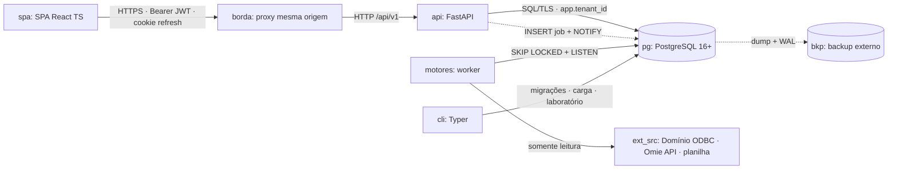

# Plano: DynaPrice

## 1. Objetivo

Construir um produto de precificação dinâmica orientada a esforço para prestadores de serviços profissionais recorrentes, começando por um escritório contábil piloto. O produto deve:

- medir o esforço-padrão de cada empresa com as equações de tempo (TDABC, Huber) do artigo;
- calcular o preço-alvo de cada **contrato** pela política P* = κ·max(π_r, τ·H_pad), em que π_r é o piso do regime tributário (ADR-003, ADR-004);
- recalibrar todo mês em malha fechada, com transição limitada (θ), gatilho (δ) e **decisão humana** em toda mudança de preço;
- explicar cada preço (piso, horas por departamento, tarifa, κ, nível de informação) e permitir refazê-lo a partir das entradas gravadas.

O que conta como sucesso no piloto: o gestor reconhece o diagnóstico, aprova recomendações com a decomposição na tela, e a tabela aprovada chega ao financeiro (Omie) e é conferida pela conciliação na competência seguinte.

Fonte da arquitetura: as saídas `mw9kw9fkffjn2` (Arquitetura e componentes) e `mw9kw9i514upw` (Processos, dados e implantação), com as ADR-001 a ADR-004. O briefing do projeto (IDEIA) foi atualizado em 2026-11-09 para refletir as ADR-001 a ADR-004.

## 2. Escopo e fora do escopo

**Dentro (MVP, F0 a F2):**
- Laboratório em `cli`: diagnóstico, estimação das equações de tempo, Ridge de controle, τ, simulação de políticas, carteira sintética (G1).
- Núcleo puro de preço: `k_pol`, `k_teq`, `k_inf`, `k_tr`, `k_gat`, `k_tar`, `k_din`, `k_agr`.
- Contrato como unidade de preço, com vínculo empresa → contrato e pendências de vínculo visíveis (`uc_vinc`, ADR-003).
- Segmentação declarada por regime tributário (MEI, SN, LP, LR) com piso π_r por regime; sem histórico, o preço é π_r; com histórico parcial, credibilidade Z (ADR-004).
- Conectores somente leitura: planilha (`a_csv`), Domínio por ODBC (`a_dom`), Omie por API (`a_omie`).
- Recalibração mensal (`m_recal`), recomendações (`d_rec`), exportação por arquivo (`d_exp`/`a_expf`), conciliação (`uc_conc`).
- Política como dado versionado e imutável, incluindo os β; estimação anual gera rascunho (`uc_estimar`), e a publicação exige aprovação (`d_pol`).
- Autenticação própria (ADR-002): JWT ES256, refresh opaco com rotação e detecção de reuso, Argon2id, TOTP obrigatório para `aprovar`/`administrar`, troca de inquilino e recuperação de acesso (`uc_auth`, `uc_recup`, `uc_users`).
- SPA React (`spa`) com diagnóstico, laboratório, recomendações, políticas, vínculos, administração; cotação em F2.
- PostgreSQL 16+ (`pg`) com RLS forçada, papéis `dynaprice_migrador` e `dynaprice_app`, auditoria encadeada por hash.

**Fora do MVP (F3 ou depois):**
- Federação OIDC (`idp`).
- Exportação por API para o Omie.
- Segmentação aprendida (k-medoides) e inferência por vizinhos (`m_viz`, Gower/kNN), que fica como opção `sem_historico: "vizinhos"` da política.
- Consultor multi-inquilino com fluxos próprios, âncora externa da auditoria, adaptador BCB/IPCA para o índice de inflação.
- Implantação em Proxmox (F4) como mais um alvo, nunca como dependência.
- GAM, florestas e boosting em produção (ficam no laboratório).
- Modelagem de cancelamento de clientes (o artigo usa simulação estática).

**Rejeitado (registrado nas ADRs):** Java/Spring, MySQL, microsserviços, barramento NATS com outbox, APScheduler, Keycloak como componente, HS256.

## 3. Arquitetura

Cliente-servidor com mesma origem (ADR-001). Um backend Python 3.12 em Clean Architecture enxuta (4 anéis verificados por import-linter), monólito modular com uma imagem e três entradas. O PostgreSQL é o único estado.

**Containers (saída `mw9kw9fkffjn2`, aba Containers):**
- `spa`: build estático Vite. Token de acesso só em memória, renovação silenciosa, cliente gerado do OpenAPI (`fe_api`). Não contém regra de preço; a guarda `fe_guard` é só conveniência de interface.
- `borda`: TLS, arquivos da SPA em `/`, `/api` encaminhado ao `api`, limite de taxa, CSP `default-src 'self'` e HSTS. Pode ser qualquer proxy.
- `api`: FastAPI. Emite e valida o JWT, mantém a política vigente em memória (recarregada por LISTEN/NOTIFY), não guarda estado de sessão e escala na horizontal.
- `motores` (rótulo "backend worker"): um laço único que enfileira os jobs agendados (`INSERT … ON CONFLICT DO NOTHING`) e consome `core.job` (`FOR UPDATE SKIP LOCKED` + LISTEN). Executa extração, conciliação, recalibração mensal, estimação anual e exportação.
- `cli`: migrações, carga histórica, laboratório offline, criação do primeiro administrador.
- `pg`: esquemas `raw` (JSONB imutável), `core` (RLS forçada), `auth` (fora da RLS por inquilino), `audit` (cadeia de hash) e `job`.
- `bkp`: pg_dump + arquivamento de WAL em destino externo.

**Anéis do backend (aba Clean Architecture):**
1. Entidades: `e_mod` (Contrato, Empresa, Vinculo, PoliticaVersao, IndiceInflacao, PrecoAlvo, Recomendacao, Cotacao, Usuario, Principal); núcleo de preço `k_pol`, `k_teq`, `k_inf`, `k_tr`, `k_gat`, `k_tar`, `k_din`, `k_agr`; estimação `m_teq` (Huber), `m_esf` (Ridge, controle e fora da fórmula), `m_sim`. Exceção declarada: `dominio/estimacao` pode importar `fw_sci`.
2. Casos de uso: `uc_auth`, `uc_users`, `uc_recup`, `uc_import`, `uc_vinc`, `uc_conc`, `uc_conn`, `uc_estimar`, `uc_simular`, `m_recal`, `d_cot`, `d_rec`, `d_pol`, `d_exp`, `m_diag`. Portas: `p_rel`, `p_sess`, `p_job`, `p_src`, `p_exp`, `p_tok`, `p_cred`, `p_cif`, `p_clock`. A autorização por papel acontece aqui.
3. Adaptadores: entrada `in_http`, `in_auth`, `in_worker`, `in_cli`; saída `a_db`, `a_dom`, `a_omie`, `a_csv`, `a_expf`, `a_jwt`, `a_hash`, `a_cif`, `a_clock`.
4. Frameworks: `fw_fastapi`, `fw_runtime`, `fw_typer`, `fw_db`, `fw_odbc`, `fw_httpx`, `fw_crypto`, `fw_sci`.

**Malha fechada (aba Pipeline):** `f_src` → `f_bruto` → `f_limpo` → `f_vinc` → `f_anal` → `f_hpad` (β publicados) → `f_agr` (Σ por contrato) → `f_inf` (nível ℓ) → `f_tr` → `f_gat` → `f_hum` → `f_exp`, com realimentação por `f_conc`. O ciclo anual `f_teq`/`f_mod`/`f_tar` só produz **rascunho** de `f_pol`.

**Regras de arquitetura que viram teste:**
- import-linter falha se algum anel depender de um anel mais externo;
- o preço tem uma única implementação (`k_pol`/`k_tr`/`k_din`), usada pela cotação, pela recalibração e pelo simulador;
- os β pertencem à versão de política: a recalibração mensal não os reestima.

## 4. Fluxos principais

A única simulação desenhada hoje é `mw9kw9i514upw:7` "Preço-alvo e transição (Tabela 7)", que cobre só o caminho feliz. As simulações de erro que faltam estão na seção 9. Cada fluxo abaixo diz o que já está desenhado e o que precisa virar simulação (teste de aceite).

**4.1 Preço-alvo e transição de um contrato (simulação `mw9kw9i514upw:7`)**
- Caminho: direcionadores médios de 12 meses (ℓ = 2, LP) → `k_teq` (fiscal 2,785 + contábil 2,483 + folha 0,667 = 5,935 h) → `k_pol` (103,5 × 5,935 = 614,27 > π_LP = 235; κ = 1) → `k_tr` (G = 1,41, t* = 3 ciclos) → `k_gat` (|ln(437/614,27)| = 0,34 > ln 1,15) → recomendação PENDENTE → gestor aprova.
- Aceite: preço-alvo 614,27 e chegada ao alvo em 3 ciclos, sem ultrapassá-lo.
- **Detalhe a fixar no teste:** com `k_din` (Decimal, ROUND_HALF_UP, 2 casas), a trajetória exata é 437 → 502,55 → 577,93 → 614,27. O artigo mostra 503 e 578, valores arredondados; a simulação do desenho já usa os valores exatos (atualizada em 2026-11-09). O teste deve usar os valores exatos, ou a política deve declarar arredondamento comercial e o teste usar o valor arredondado.
- Caminhos de erro **não simulados:** piso vinculante (τ·H_pad < π_r), alvo abaixo do preço vigente (congela o nominal, Algoritmo 3), desvio dentro da zona morta (nenhuma recomendação), κ fora de κ̄ (rejeitado na criação).

**4.2 Recalibração mensal (sequência "recalibração")**
- Caminho: `motores` vê a competência fechada (`p_clock` + `dias_fechamento`) → job `extrair` (idempotente por tenant, tipo e competência) → `uc_import` via `p_src` com credenciais decifradas só em memória (`p_cif`) → `raw` (nova versão em reextração) → validação/quarentena → empresa×mês → pendências de vínculo (`uc_vinc`) → `uc_conc` → job `recalibrar` → `m_recal` fixa a política publicada vN → H_pad por empresa → Σ por contrato (`k_agr`) → nível ℓ (`k_inf`) → P* → transição e gatilho só para contratos com reajuste na janela → expira as PENDENTE antigas, grava as novas com entradas usadas → COMMIT.
- Erros desenhados só em texto (Revisão 2, G5): job `falhou` com erro e nova tentativa manual; empresa sem vínculo fica fora e aparece na interface.
- Erros **sem simulação:** conector indisponível ou com credencial inválida; tempo esgotado no ODBC; extração parcial; competência sem vínculo para uma empresa que tem horas; reextração que muda um mês já recalibrado; worker que morre no meio do job.

**4.3 Decisão e exportação (estados da recomendação)**
- PENDENTE → APROVADA (aprova ou ajusta κ com justificativa, papel `aprovar` + TOTP) → EXPORTADA (`d_rec` agenda job, `d_exp` gera arquivo por `a_expf`). PENDENTE → REJEITADA (com motivo) ou EXPIRADA (pela recalibração seguinte).
- Erros **sem desenho:** falha ao gerar ou entregar o arquivo (APROVADA fica presa, sem estado de falha); decisão concorrente de dois gestores; ajuste de κ acima de κ̄.

**4.4 Conciliação (`uc_conc`)**
- Depois de cada importação, compara o aprovado com o cobrado (HONORARIO_MES) e gera DIVERGENCIA_COBRANCA, com alerta ao gestor (`f_conc` → `f_hum`).
- **Sem simulação nem estados:** o ciclo de vida da divergência (aberta, justificada, resolvida) não está desenhado.

**4.5 Cotação (sequência "cotação", entra em F2)**
- `POST /api/v1/cotacoes` com o regime obrigatório → `in_auth` gera o Principal → transação com `app.tenant_id` → política vigente em memória → sem histórico, π_r; com histórico parcial de m meses, Z = m/(m + s²/v²) e P = κ·[Z·max(π_r, τ·H_pad,pr) + (1−Z)·π_r] → grava a cotação com entradas e versão → 201 com decomposição e motivo.
- **Sem simulação:** os dois ramos (sem histórico, parcial), regime ausente (422), política não publicada no tenant, política em memória desatualizada.

**4.6 Autenticação (sequência "autenticação JWT")**
- Login com senha (Argon2id) → desafio TOTP → família de refresh (hash) → access de 15 min em memória + cookie HttpOnly/SameSite=Strict → renovação com rotação → sair revoga a família.
- O reuso de refresh está como `alt` na sequência (revoga a família e audita), mas **não tem simulação**. Também não têm simulação: bloqueio progressivo por força bruta, troca de inquilino (`POST /auth/inquilino`), recuperação de senha e de MFA (`uc_recup`), rotação da chave ES256 (`kid`).

**4.7 Estimação anual e publicação (estados da política)**
- O job `estimar_politica` (`uc_estimar`: `m_teq`, `m_esf`, `k_tar`, `m_sim`) gera um Rascunho com relatório de estimação → ajustes no laboratório → Publicada (papel `aprovar`, imutável; NOTIFY recarrega o `api`) → Substituída.
- **Sem simulação:** portão de aceite reprovado (equações de tempo piores que as vigentes), publicação concorrente, publicação errada que precisa voltar atrás (não há estado de revogação).

**4.8 Vínculos e carga histórica**
- `uc_vinc` mantém VINCULO com histórico (desde/até) e empresa principal; `cli` faz a carga histórica por `uc_import`. Ainda **sem sequência nem simulação**.

## 5. Dados

Fonte: aba "Modelo de dados" de `mw9kw9i514upw`. Tudo fica em `pg`.

| Esquema | Entidades | RLS | Observação |
|---|---|---|---|
| `auth` | USUARIO, USUARIO_PAPEL, SESSAO_FAMILIA, REFRESH_TOKEN, CODIGO_RECUPERACAO | fora da RLS por inquilino; acesso só pelos casos de uso de autenticação | senha em Argon2id, refresh só como hash SHA-256, TOTP cifrado |
| `core` | TENANT, CONTRATO, EMPRESA, VINCULO, EMPRESA_MES, HONORARIO_MES, INDICE_INFLACAO, POLITICA_VERSAO (+ EQUACAO_TEMPO, PISO_SEGMENTO, RELATORIO_ESTIMACAO), PRECO_ALVO, RECOMENDACAO, DIVERGENCIA_COBRANCA, COTACAO, CONECTOR_CONFIG | forçada, `tenant_id` em toda tabela | POLITICA_VERSAO publicada é imutável; PRECO_ALVO guarda as entradas para refazer o cálculo |
| `raw` | EXTRACAO_RAW | forçada | JSONB imutável, uma linha por extração e versão |
| `job` | JOB | forçada | chave natural (tenant, tipo, competência) |
| `audit` | AUDIT_EVENTO | forçada | cadeia de hash (seq, hash); âncora externa em F3 |

**Sensível e dono:**
- **CNPJ/CPF:** `EMPRESA.documento_cifrado`. No MEI, o CNPJ identifica uma pessoa física, e a razão social do MEI costuma conter o nome e o CPF do titular. Por isso o `EMPRESA.perfil` (JSONB) e o `raw` também podem carregar dado pessoal. Dono a definir (seção 10).
- **Folha:** o Domínio guarda dados de empregados (nome, CPF, salário). O produto só precisa de **contagens** (empregados, eventos). O conector deve projetar só os agregados, sem trazer linhas de empregado para o `raw`. Isso é minimização exigida pelo RNF05 e precisa de teste.
- **Credenciais dos conectores:** `CONECTOR_CONFIG.credencial_cifrada` (envelope AES-256-GCM, `p_cif`). Nunca retornadas pela API.
- **Segredos de autenticação:** TOTP cifrado, códigos de recuperação em Argon2id, chave ES256 e chave mestra injetadas pela implantação, nunca no banco nem no repositório.
- **Logs:** lista de campos proibidos (e-mail, CPF/CNPJ, token, senha), com teste (S7).

**Retenção:** não está definida em nenhum lugar do desenho. A proposta para decisão está na seção 10 (D6).

**Cópia de segurança:** `bkp` (pg_dump + WAL externo, restauração ensaiada). RPO e RTO não estão definidos (seção 9).

**Divergências do modelo com as ADRs:**
- ~~COTACAO_VIZINHO no ER e "vizinhos" em `fe_cot`~~. Resolvido em 2026-11-09: a tabela saiu do ER do MVP (volta em F3 com `m_viz`) e `fe_cot` foi alinhado à ADR-004.
- INDICE_INFLACAO está por tenant. IPCA é dado global; por tenant só faz sentido se cada escritório puder escolher outro índice. A confirmar.
- JOB, EXTRACAO_RAW, TENANT e USUARIO_PAPEL aparecem no ER sem atributos. Faltam estado, tentativas, `lease`/heartbeat e erro no JOB.
- RECOMENDACAO não mostra `contrato_id` nem versão de política (chegam por PRECO_ALVO). Convém deixar isso explícito para consulta e auditoria.

## 6. Integrações e ambiente

**Perfil:** não existe `.ada/perfil.json`. Ainda não há mapa de onde cada nó roda, como se testa ou como se publica. O desenho de implantação é agnóstico (`dp_proxy`, `dp_web`, `dp_worker`, `dp_pg`, `dp_bkp`, `dp_src`), e o Proxmox é só alvo de F4. Antes de F1, criar o perfil com pelo menos: ambiente local (compose), CI, registro da imagem e o primeiro ambiente do piloto.

**Integrações:**

| Integração | Nó | Protocolo | Direção | Autenticação | Observação |
|---|---|---|---|---|---|
| Domínio (escrituração) | `src_esc` / `a_dom` | ODBC (`fw_odbc`) | leitura | usuário somente leitura do banco, credencial cifrada | Hipótese: banco SQL Anywhere na rede do escritório. Driver ODBC para Linux no contêiner e licença a confirmar. Exige alcance de rede do `motores` até o servidor do Domínio |
| Omie (financeiro) | `src_fin` / `a_omie` | HTTPS/JSON (`fw_httpx`) | leitura; escrita só em F3 | app_key/app_secret cifrados | limites de taxa da API a confirmar; MVP exporta por arquivo |
| Cadastro/perfil | `src_cad` | via Domínio ou planilha | leitura | — | regime tributário obrigatório |
| Planilhas | `planilha` / `a_csv` | upload CSV/XLSX | leitura | usuário autenticado | carga histórica e plano B de qualquer conector |
| Exportação | `a_expf` | arquivo | saída | download autenticado | layout de importação do Omie a confirmar |
| OIDC | `idp` | OIDC | entrada | — | só F3 |
| Índice de inflação | — | manual auditado | entrada | papel `administrar`? | adaptador BCB em F3 |

**Teste:** pytest + hypothesis (propriedades do núcleo contra as Proposições 3, 7 e 8), carteira sintética (G1) como insumo do CI, relógio fixo (`p_clock`), sementes fixas e `OMP_NUM_THREADS=1` (G3), import-linter, teste de isolamento entre tenants com o papel `dynaprice_app`, teste de rotas sem papel declarado (S5), verificação do contrato OpenAPI ↔ tipos TS (G4). A ferramenta de teste do frontend (unidade e ponta a ponta) não está escolhida (seção 9).

**Publicação:** monorepo (`backend/`, `frontend/`, `docs/adr/`, `deploy/compose/`), imagem OCI única `dynaprice-backend:<versão>` com `cmd=api|worker|cli`, SPA como arquivos estáticos servidos pela `borda`. Cadeia de suprimentos (S6): lockfiles, Renovate, SBOM (syft), trivy, pip-audit/npm audit.

## 7. Requisitos não funcionais

**Segurança**
- Isolamento (RNF03): RLS forçada; `app.tenant_id` por transação na `api` e por job no `motores`; `dynaprice_app` sem BYPASSRLS e sem DDL. Teste obrigatório: ler outro tenant deve falhar.
- Autenticação e sessão: ADR-002 (ES256, `kid`, JWKS, 15 min de acesso, refresh com 12 h de inatividade e 7 dias absolutos, detecção de reuso, TOTP obrigatório para `aprovar`/`administrar`, limite por IP e por conta). O código de autenticação precisa de revisão de segurança dedicada (consequência da ADR-002).
- Autorização: matriz papel × caso de uso no anel 2 (S5).
- Em trânsito e em repouso (RNF04): TLS na `borda` e no SQL; cifragem do disco do `pg` e do `bkp` depende do ambiente (a confirmar no perfil).
- Integridade da trilha (RNF06): cadeia de hash; âncora externa em F3.
- LGPD (RNF05): minimização (folha só agregada), base legal registrada, dono do dado pessoal (seção 10).

**Desempenho**
- Cotação: p95 < 300 ms e erro < 0,5% (RNF02). Hipótese: folgado, porque o núcleo leva milissegundos para 10³ contratos.
- Simulação no laboratório: síncrona, em segundos, para 10³ contratos.
- Recalibração mensal de um tenant: meta proposta de menos de 5 minutos, sem contar a extração (a confirmar em F0).

**Disponibilidade**
- Perfil de nó único no MVP: meta declarada a partir do hospedeiro (RNF01, seção 7.8 do artigo). Os 99,9% do perfil de alta disponibilidade não fazem parte do MVP.
- Atualidade dos conectores < 24 h (RNF08). Com recalibração mensal e competência que fecha N dias depois do fim do mês, atraso de horas não muda o preço. O efeito prático é sobre o diagnóstico e a conciliação.
- Indisponibilidade das fontes não pode bloquear a decisão sobre recomendações já geradas (seção 9).

**Custo**
- Uma VM ou um host com três contêineres (proxy, api/worker, postgres) e um destino de backup externo. Nenhum serviço gerenciado obrigatório.

**Reprodutibilidade**
- Todo PrecoAlvo e toda Cotacao gravam entradas e versão de política; `cli recalcular --id` refaz o cálculo e deve dar o mesmo valor ao centavo (D6).

## 8. Riscos

| Risco | Impacto | Mitigação |
|---|---|---|
| Horas registradas omitem atendimento fora do sistema (teto de R² perto de 0,77) | Lucro Real subestimado | tempo fixo por segmento (β0,m,r); relatório de resíduos por regime em F0 |
| Subprecificação no período provisório (ADR-004): cliente novo de alto esforço paga π_r | perda de receita | credibilidade Z desde o 1º mês; revisão integral em ℓ = 2; relatório mensal "provisórios abaixo do esforço medido" |
| Domínio inacessível pela rede ou driver ODBC sem versão Linux ou sem licença | F1 sem dado automático | plano B por planilha; validar o acesso em F0; decidir onde o `motores` roda (seção 10) |
| Limites ou mudanças na API do Omie | extração lenta ou quebrada | paginação com backoff; planilha como plano B; teste de contrato com respostas gravadas |
| Vínculo empresa ↔ contrato incompleto (o artigo descartou 10%) | esforço sem preço | fila de pendências; empresa sem vínculo nunca entra em silêncio |
| Regra "segmento = empresa principal" errada em contratos mistos | piso errado | decisão D1; relatório de contratos mistos em F0 |
| Transição de 3 ciclos com cliente insatisfeito ou cancelando (simulação estática) | churn | θ e δ conservadores; medir aceitação na transição; decisão humana sempre |
| Vazamento entre tenants por erro de código | grave (RNF03) | RLS forçada e papel sem BYPASSRLS; teste de isolamento no CI |
| Código próprio de autenticação com falha | tomada de conta | revisão de segurança dedicada; testes de reuso, força bruta e recuperação; TOTP obrigatório para quem aprova |
| Dado pessoal (CPF de MEI, empregados) entrando no `raw` | LGPD | projeção mínima no conector; teste de campos proibidos; retenção definida |
| Política em memória desatualizada se o NOTIFY se perder | cotação com versão errada | recarregar ao reconectar e conferir a versão por requisição (seção 9) |
| Divergência de centavos entre tela, arquivo e financeiro | contestação | `k_din` como ponto único de arredondamento; conciliação |
| Briefing desatualizado orientar o planejador ou a execução | retrabalho | IDEIA atualizada em 2026-11-09; manter sincronizada a cada nova ADR |

## 9. Lacunas do desenho

**Fluxos sem caminho de erro (nenhuma simulação cobre falha, tempo esgotado ou repetição).** Hoje só existe a simulação `mw9kw9i514upw:7`, que é o caminho feliz. Simulações a desenhar (cada uma vira teste de aceite):
1. **Conector indisponível**: o Domínio ou o Omie não responde ou recusa a credencial; job `falhou`, tentativas, alerta, decisão de seguir com planilha. Hoje não existe política de tentativas nem backoff.
2. **Competência sem vínculo**: empresa com horas e sem contrato na competência fica fora do cálculo, aparece na fila de `uc_vinc`, e o vínculo feito depois dispara (ou não) um recálculo.
3. **Reuso de refresh**: um token já usado revoga a família inteira e audita; o uso legítimo concorrente (duas abas) não pode derrubar a sessão por engano. Falta definir a janela de tolerância.
4. **Contrato provisório revisado**: o contrato chega a ℓ = 2 e tem revisão integral sem θ (Algoritmo 3, linha 1); variante em que o alvo fica abaixo do provisório.
5. **Piso vinculante e alvo abaixo do vigente** (congela o nominal).
6. **Contrato fora da janela de reajuste**: monitorado, sem recomendação com efeito.
7. **Falha na exportação** e **divergência na conciliação**.
8. **Cotação**: sem histórico, histórico parcial, regime ausente.
9. **Portão de aceite reprovado** na estimação anual.
10. **Isolamento**: requisição com o token do tenant A tentando ler dado do tenant B.

**Fila (`core.job`) sem garantias completas:**
- O consumidor existe (`motores`). A fila de mensagens mortas é só o estado `falhou` com nova tentativa manual: falta definir número de tentativas, backoff e alerta.
- A idempotência por (tenant, tipo, competência) serve para extrair, recalibrar e estimar, mas não para **exportar** (uma por recomendação ou lote?) nem para reextração.
- Como a extração roda fora da transação (G5), o lock do SKIP LOCKED não basta: se o worker morrer, o job fica `em_execucao` para sempre. Falta lease/heartbeat e recuperação de jobs órfãos.
- Não há diagrama de estados do JOB.

**Componentes externos sem plano para indisponibilidade:**
- `src_esc` (Domínio) e `src_fin` (Omie): o desenho cita a planilha como plano B, mas não diz quem decide usar a planilha, como se evita duplicidade com uma extração posterior, nem o que acontece com a competência se a fonte só voltar depois do fechamento.
- Disponibilidade e janelas de manutenção do Domínio e do Omie no escritório piloto: a confirmar.
- `idp` (F3): sem plano, aceitável até lá.

**Fronteiras de confiança:**
- `motores` → Domínio por ODBC: não está definido se o banco aceita TLS nem como o `motores` alcança a rede do escritório (VPN, agente local ou implantação na própria rede). Isso é decisão (seção 10, D9).
- `spa` → `borda` → `api`: autenticada (ADR-002). O upload de planilha precisa de limite de tamanho e de validação de conteúdo (XLSX com fórmulas e macros).
- `api` → `pg` e `motores` → `pg`: SQL/TLS com papel `dynaprice_app`. A forma de provisionar a credencial do papel não está desenhada.

**Armazenamento (`pg`, `bkp`):**
- Não há retenção definida para `raw`, `audit`, cotações, refresh tokens expirados e divergências (proposta em D6).
- `bkp` não tem RPO nem RTO, cifragem nem frequência do ensaio de restauração.
- Dado sensível sem dono: CPF/CNPJ de MEI no `documento_cifrado`, no `perfil` e no `raw`; não há designação de controlador/operador entre o escritório e o produto.
- A rotação da chave mestra do `p_cif` (recifrar CONECTOR_CONFIG e TOTP) não está desenhada.

**Máquinas de estado:**
- Recomendação: APROVADA só sai por EXPORTADA, e uma falha na exportação a prende. Falta FALHA_EXPORTACAO ou nova tentativa, e falta dizer o que acontece com uma APROVADA não exportada quando chega a recalibração seguinte.
- Política: Publicada só sai por Substituída; não há como revogar uma publicação errada além de publicar outra. Isso pode ser aceitável, mas precisa ser decidido.
- Faltam diagramas de estado para Contrato (provisório → definitivo, ativo → encerrado), Divergência de cobrança, Job e Vínculo.
- Cotação → contrato: não está desenhado como uma cotação aceita vira Contrato provisório.

**Nós sem responsabilidade clara (`info` vazio):** `fw_typer`, `in_worker`, `in_cli`, `a_dom`, `a_omie`, `a_csv`, `a_expf`, `a_hash`, `uc_import`, `k_teq`, `k_gat`, `m_teq`, `m_sim`, `p_job`, `p_exp`, `s_rec`, `s_ges`, `dp_user`, `dp_src`. Em geral a responsabilidade se deduz pelo nome, mas `p_job` (contrato da fila) e `p_exp` (formato do arquivo) precisam de definição.

**Ligações sem rótulo:** quase todas as dependências `in_http` → casos de uso e casos de uso → portas na aba Clean Architecture. Em dependência de código isso é aceitável. As ligações `f_bruto` → `f_limpo` e `f_tr` → `f_gat` deveriam dizer o que passa.

**Nós fora de um mapa de implantação:** não há perfil, então nenhum nó tem lugar de execução definido. O `cli` não aparece no diagrama de implantação (presumivelmente roda como contêiner avulso com a mesma imagem; a confirmar).

**Regras de domínio sem desenho:**
- Mudança de regime tributário no meio da janela de 12 meses (por exemplo, de SN para LP em janeiro): qual β0 e qual piso usar, e se o contrato volta a ser provisório.
- Frequência de revisão do provisório: todo mês, enquanto ℓ < 2, ou só na data de reajuste?
- Critério do portão de aceite das equações de tempo (o Algoritmo 4 do artigo usava o R² do Ridge, que saiu do caminho do preço pela correção E2).
- Origem de H_pad,pr na cotação com histórico parcial: digitado pelo analista ou lido de um cliente já importado?
- Política em memória: o que acontece se o NOTIFY se perder (reconexão do LISTEN, conferência de versão).
- Concorrência na cadeia de hash da auditoria (serializar por tenant).

**Engenharia:** ferramentas de teste do frontend (unidade e ponta a ponta) não escolhidas; observabilidade (métricas, onde ficam os logs, alertas de job falho) não desenhada.

## 10. Decisões em aberto

| # | Pergunta | Opções | Recomendação |
|---|---|---|---|
| D1 | Qual o segmento (piso) de um contrato com empresas de regimes diferentes? | (a) regime da empresa principal (ADR-003 atual); (b) regime de maior piso entre as empresas; (c) soma dos pisos de cada empresa; (d) regime da empresa com maior H_pad | (a), com a empresa principal marcada no vínculo e um relatório de contratos mistos em F0 para o escritório validar. Se a principal for MEI/SN e houver uma LP/LR no contrato, alertar. Se o escritório cobra o "regime mais caro", ficar com (b). Só (c) contraria o "um piso por contrato" já confirmado |
| D2 | Valores iniciais de π_r (MEI, SN, LP, LR) | (a) piso estatístico do artigo (percentil baixo do preço praticado por regime) a partir da análise F0; (b) tabela atual do escritório; (c) custo mínimo de atendimento por regime | (a), calculado em F0 com os dados reais, comparado com (b), e publicado na primeira versão de política com aprovação do gestor. Não codificar valores: o 235 do LP na simulação é mascarado |
| D3 | Origem da tarifa τ | (a) preço revelado (τ̂ = ΣF/ΣH_pad, como no artigo); (b) custo completo por hora, se houver DRE por departamento; (c) τ* de receita constante | (a) no MVP, com τ* só como referência (já está em `f_tar`). Perguntar ao escritório se existe DRE por departamento; se existir, avaliar (b) em F0 como alternativa, porque ancora no custo e não perpetua o preço histórico |
| D4 | θ (teto real de alta por ciclo) e δ (gatilho) iniciais | (a) 15% e 15% (artigo); (b) θ menor (10%) para reduzir atrito, ao custo de mais ciclos; (c) θ por regime | (a) como ponto de partida, com sensibilidade simulada em F0 (receita, % de contratos no teto, ciclos até o alvo) e decisão do gestor no laboratório |
| D5 | Quem é o "gestor" que aprova (papel `aprovar`)? | (a) sócio(s) do escritório; (b) gerente comercial/financeiro; (c) dois níveis (analista propõe, sócio aprova acima de um limite) | Pergunta ao escritório. Recomendo (a) no piloto, com TOTP obrigatório e no máximo 2 pessoas. Proibir que a mesma pessoa ajuste κ e aprove a própria política? A confirmar |
| D6 | Política de retenção | ver proposta ao lado | Proposta, a confirmar com o escritório e o jurídico: `raw` com 24 meses depois de substituído por nova versão (o necessário para reprocessar a janela de 12 meses e a estimação anual); `core` analítico e preços enquanto o contrato estiver ativo + 5 anos (prazo de cobrança); `audit` com 5 anos no mínimo, nunca apagado antes do backup; refresh e códigos expirados com 30 dias; cotações não convertidas com 12 meses; backups com 35 dias de WAL + mensais por 12 meses |
| D7 | Janela de reajuste por contrato | (a) mês de aniversário do contrato (`mes_reajuste`), com recomendação gerada 1 a 2 meses antes; (b) um mês fixo para toda a carteira (ex.: janeiro); (c) trimestral | (a), que respeita o contrato e espalha as conversas. Definir quantos meses de antecedência (proposta: recomendação na recalibração de 2 meses antes do mês de efeito). Contratos sem `mes_reajuste` conhecido ficam pendentes de cadastro |
| D8 | Sensibilidade e dono do CPF/CNPJ (MEI) e base legal | (a) o escritório é controlador e o DynaPrice é operador; (b) produto próprio como controlador | (a), com documento cifrado, `perfil` sem nome de pessoa física, mascaramento na interface e base legal "execução de contrato/legítimo interesse" registrada (a confirmar com jurídico) |
| D9 | Onde o `motores` roda em relação ao Domínio | (a) toda a stack na rede do escritório; (b) stack fora + agente de extração local que envia para a API; (c) stack fora + VPN até o banco do Domínio; (d) só planilha no piloto | Para o piloto, (a) ou (d). (b) é o caminho de produto multi-inquilino (F3), mas cria um componente novo e não deve entrar no MVP |
| D10 | Dias para fechar a competência (`dias_fechamento`) | 5, 10, 15 dias | Medir em F0 quando os lançamentos de um mês param de mudar; proposta inicial de 10 dias |
| D11 | Arredondamento comercial | (a) só centavos (ROUND_HALF_UP); (b) múltiplo de 5,00 ou 10,00 | Perguntar ao escritório. Se (b), a regra entra na política e o teste da Tabela 7 usa o valor arredondado |
| D12 | κ̄ (limite do ajuste do gestor) e exigência de justificativa | ±10%, ±20% | ±20% com justificativa obrigatória acima de ±5%; confirmar com o gestor |
| D13 | Mudança de regime dentro da janela | (a) reinicia o histórico (provisório); (b) usa os meses do regime novo e trata o anterior como parcial; (c) ignora | (b), com nível ℓ recalculado só com meses do regime atual |
| D14 | Atualizar o briefing (IDEIA) do projeto | atualizar agora; manter | Decidido em 2026-11-09: atualizado para refletir as ADR-001 a ADR-004 |

## 11. Marcos

Cada marco deixa algo de pé e tem um critério verificável. Os marcos viram as fases da execução.

**F0 — Laboratório**
- Deixa de pé: monorepo, `cli` com o núcleo puro (`k_pol`, `k_teq`, `k_tr`, `k_gat`, `k_tar`, `k_din`, `k_agr`, `k_inf`) e a estimação (`m_teq`, `m_esf`, `m_sim`); gerador de carteira sintética (G1); diagnóstico, estimação e simulação sobre a carteira sintética e sobre os dados reais do escritório (exportados por planilha ou leitura somente leitura assistida); relatório com π_r por regime, τ̂/τ*, β, sensibilidade de θ/δ, s²/v², contratos mistos, dias de fechamento.
- Critérios:
  - teste do núcleo: a Tabela 7 dá preço-alvo 614,27 e chega ao alvo em 3 ciclos sem ultrapassá-lo (trajetória exata 437 → 502,55 → 577,93 → 614,27);
  - testes de propriedade (hypothesis) das Proposições 3, 7 e 8 passam;
  - import-linter verde com a exceção declarada para `dominio/estimacao`;
  - na carteira sintética, os β estimados ficam dentro do intervalo dos β geradores; nos dados reais, R² e β coerentes com a seção 9 do artigo;
  - o gestor reconhece o diagnóstico e aprova o relatório que dá os valores das decisões D2, D3, D4, D10.

**F1 — Núcleo, recalibração, recomendações, autenticação e interface mínima**
- Deixa de pé: `pg` com esquemas, RLS forçada e papéis; `api`, `motores` e `cli` na mesma imagem; `uc_auth`/`uc_users`/`uc_recup` (ADR-002); conectores `a_csv` → `a_dom` → `a_omie` com `uc_conn` e `p_cif`; `uc_import`, `uc_vinc`, `m_recal`, `d_rec`, `d_pol`, `uc_estimar`, `d_exp`/`a_expf`, `uc_conc`, `m_diag`; SPA com login+MFA, recomendações, políticas, vínculos, diagnóstico e administração; compose local; CI com contrato OpenAPI, SBOM e varredura; perfil do ambiente do piloto.
- Critérios:
  - teste de isolamento: com o papel `dynaprice_app` e `app.tenant_id` = A, toda leitura e escrita em dados do tenant B retorna vazio ou falha, em todas as tabelas de `core`, `raw`, `job` e `audit`;
  - recalibração ponta a ponta sobre a carteira sintética gera, para o contrato da Tabela 7, recomendação PENDENTE com alvo 614,27 e trajetória de 3 ciclos; `cli recalcular --id` reproduz o valor ao centavo;
  - simulação de reuso de refresh: o segundo uso do mesmo token revoga a família e o próximo `/auth/renovar` devolve 401;
  - teste que percorre todas as rotas falha se alguma não declarar papel; aprovar sem TOTP é recusado;
  - simulações de erro "conector indisponível" e "competência sem vínculo" passam: job `falhou` com nova tentativa, empresa sem vínculo listada e fora do cálculo;
  - repetir o job `extrair` ou `recalibrar` da mesma competência não duplica nada;
  - restauração do backup em ambiente limpo reproduz a última recomendação.

**F2 — Cotação e validação**
- Deixa de pé: `d_cot` e a tela `fe_cot` (regime obrigatório, π_r sem histórico, credibilidade Z com histórico parcial, decomposição); revisão integral do provisório em ℓ = 2; relatório "provisórios abaixo do esforço medido"; protocolo de ocultação (seção 10.5 do artigo) comparando `piso_regime` com credibilidade e, offline, com vizinhos.
- Critérios:
  - p95 da cotação < 300 ms e erro < 0,5% sob carga de referência (a definir, proposta de 20 req/s);
  - simulação "contrato provisório revisado" passa (revisão integral sem θ ao chegar a ℓ = 2);
  - EPAM da inferência medido por ocultação e registrado no relatório de estimação;
  - cotação com o mesmo insumo e a mesma versão de política dá o mesmo preço depois da publicação de uma nova versão (reprodutibilidade).

**F3 — Produto multi-inquilino**
- Deixa de pé: federação OIDC (`idp`) mantendo o JWT próprio; consultor com vários inquilinos; exportação por API para o Omie; segmentação aprendida e `m_viz` como opção `sem_historico: "vizinhos"`; âncora externa da auditoria; adaptador BCB/IPCA; pacote vertical documentado; agente de extração, se D9 exigir.
- Critérios:
  - um segundo inquilino real entra em produção sem mudança no código de `dominio/` (só configuração e adaptador);
  - o consultor troca de inquilino e o teste de isolamento continua verde com o token emitido pela troca;
  - a exportação por API é idempotente: reenviar a mesma tabela aprovada não duplica lançamentos no Omie (verificado em conta de homologação);
  - a cadeia de auditoria verificada contra a âncora detecta a alteração de um evento.

**F4 — Implantação**
- Deixa de pé: perfil Proxmox (zonas, firewall com negação por padrão, backup 3-2-1) como mais um alvo de implantação, usando a mesma imagem e o mesmo compose/manifesto.
- Critérios:
  - nenhuma alteração em `dominio/` ou `aplicacao/` para implantar (RNF09), verificável pelo diff;
  - ensaio de restauração completo dentro do RTO definido (a definir; proposta de 4 h) e com perda dentro do RPO (proposta de 15 min com WAL);
  - meta de disponibilidade do perfil de nó único declarada e medida por um mês.
